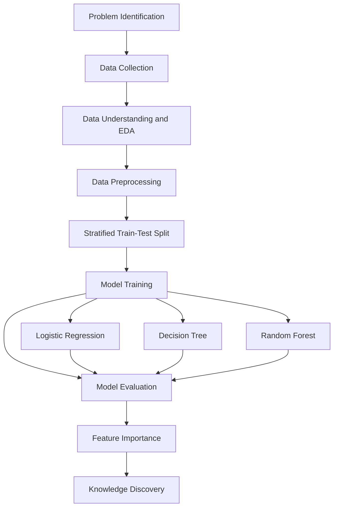

# 🏦 Company Bankruptcy Prediction Using Machine Learning

<p align="center">
  
  
  
  
  
</p>

<p align="center">
  <strong>An End-to-End Predictive Analytics Project for Financial Risk Assessment</strong>
  <br>
  Predicting corporate bankruptcy using historical financial indicators, supervised machine learning, and the KDD knowledge discovery process.
</p>

<p align="center">
  <a href="#-overview">Overview</a> •
  <a href="#-dataset">Dataset</a> •
  <a href="#-methodology">Methodology</a> •
  <a href="#-results">Results</a> •
  <a href="#-feature-importance">Feature Importance</a> •
  <a href="#-getting-started">Getting Started</a>
</p>

---

## 📌 Table of Contents

<details open>
<summary><strong>Explore the project</strong></summary>

- [Overview](#-overview)
- [Objectives](#-project-objectives)
- [Dataset](#-dataset)
- [Methodology](#-methodology)
- [Machine Learning Models](#-machine-learning-models)
- [Results](#-results)
- [Confusion Matrix](#-random-forest-confusion-matrix)
- [Feature Importance](#-feature-importance)
- [Project Structure](#-project-structure)
- [Technologies Used](#-technologies-used)
- [Getting Started](#-getting-started)
- [Report and Presentation](#-report-and-presentation)
- [References](#-references)
- [Author](#-author)
</details>

---

## 🔍 Overview

Corporate bankruptcy can have significant consequences for investors, creditors, employees, and the broader economy. Identifying potential financial distress early can support better risk assessment and decision-making.

This project develops and evaluates machine learning classification models to predict whether a company is bankrupt or non-bankrupt based on its financial indicators.

The project implements three models:

- **Logistic Regression** — baseline classification model.
- **Decision Tree** — interpretable, rule-based classification.
- **Random Forest** — ensemble learning model selected for its overall test-set performance.

The complete workflow follows the **KDD (Knowledge Discovery in Databases)** process, covering data understanding, preprocessing, model development, evaluation, and interpretation.

### ✨ Key Highlights

| Feature | Description |
|---|---|
| 📊 Dataset | 6,819 company records |
| 🧮 Predictors | 94 financial indicators |
| 🤖 ML Models | Logistic Regression, Decision Tree, Random Forest |
| ⚖️ Imbalance Handling | Class weighting |
| 🔬 Evaluation | Accuracy, Precision, Recall, F1, ROC-AUC and PR-AUC |
| 🛡️ Leakage Prevention | Pipeline-based preprocessing |
| 🏆 Selected Model | Random Forest |
| 📚 Methodology | KDD process |

## 🎯 Project Objectives

- Analyze historical company financial data to identify patterns associated with bankruptcy.
- Build classification models to estimate bankruptcy risk.
- Address the severe imbalance between bankrupt and non-bankrupt companies.
- Compare models using metrics beyond accuracy.
- Identify financial indicators associated with the models' predictions.
- Demonstrate a reproducible end-to-end predictive analytics workflow.

---

## 📂 Dataset

**Primary source:** [Taiwanese Company Bankruptcy Prediction — UCI Machine Learning Repository](https://archive.ics.uci.edu/dataset/572/taiwanese+bankruptcy+prediction)

**Alternative source:** [Company Bankruptcy Prediction — Kaggle](https://www.kaggle.com/datasets/fedesoriano/company-bankruptcy-prediction)

### Dataset Summary

| Property | Value |
|---|---:|
| Total records | 6,819 |
| Predictor variables | 94 |
| Target variable | `Bankrupt?` |
| Bankrupt companies | 220 (3.23%) |
| Non-bankrupt companies | 6,599 (96.77%) |
| Missing values | 0 |
| Duplicate records | 0 |

The financial indicators cover several dimensions of corporate performance, including profitability, leverage, liquidity, debt dependency, and operating efficiency.

### ⚠️ Class Imbalance

Only approximately **3.23%** of the companies in the dataset belong to the bankrupt class. Consequently, a model can achieve high accuracy simply by predicting the majority class.

For this reason, the project emphasizes **recall, F1-score, ROC-AUC, and PR-AUC** alongside accuracy and precision.

---

## 🔄 Methodology

The project follows the KDD process to transform raw financial data into useful predictive insights.



### Data Preprocessing

1. Separate the predictor variables from the target variable.
2. Split the dataset into training and testing sets using an 80:20 stratified split.
3. Use class weighting to reduce the effect of class imbalance.
4. Apply pipeline-based preprocessing where required.
5. Fit preprocessing steps on training data rather than the complete dataset to help prevent data leakage.
6. Evaluate the trained models on the held-out test set.

---

## 🤖 Machine Learning Models

<details>
<summary><strong>1. Logistic Regression</strong></summary>

A linear classification model used as a baseline. It estimates the probability of bankruptcy from the financial predictors.

**Purpose:** Establish a baseline and evaluate whether linear decision boundaries can distinguish bankrupt companies.
</details>

<details>
<summary><strong>2. Decision Tree Classifier</strong></summary>

A tree-based classifier that learns decision rules from financial indicators.

**Purpose:** Capture nonlinear relationships while providing a relatively interpretable decision structure.
</details>

<details open>
<summary><strong>3. Random Forest Classifier</strong></summary>

An ensemble of decision trees whose predictions are combined to improve generalization.

**Purpose:** Capture complex patterns and interactions among financial indicators while reducing reliance on an individual tree.

**Selection:** Random Forest was chosen based on the reported balance of precision, recall, F1-score, ROC-AUC, and PR-AUC.
</details>

---

## 📈 Results

### Model Performance Comparison

The following results are based on the reported held-out test-set evaluation.

| Model | Accuracy | Precision | Recall | F1-Score | ROC-AUC | PR-AUC |
|---|---:|---:|---:|---:|---:|---:|
| 🏆 **Random Forest** | **0.9538** | 0.3733 | **0.6364** | **0.4706** | **0.9499** | **0.4897** |
| Decision Tree | 0.9186 | 0.2362 | 0.6818 | 0.3509 | 0.8085 | 0.2002 |
| Logistic Regression | 0.8783 | 0.1856 | 0.8182 | 0.3025 | 0.9171 | 0.3190 |

### Key Findings

- **Highest accuracy:** Random Forest, at 95.38%.
- **Highest F1-score:** Random Forest, at 0.4706.
- **Highest ROC-AUC:** Random Forest, at 0.9499.
- **Highest PR-AUC:** Random Forest, at 0.4897.
- **Highest recall:** Logistic Regression, at 0.8182.
- **Model selection:** Random Forest provides the strongest overall balance under the reported evaluation metrics.

> **Important:** Logistic Regression has higher recall, meaning it identifies a larger proportion of actual bankrupt companies at the evaluated threshold. Random Forest has a better F1-score and PR-AUC, but its precision remains limited. The preferred model ultimately depends on the relative costs of missed bankruptcies and false alarms.

### Understanding the Evaluation Metrics

| Metric | What it measures |
|---|---|
| Accuracy | Proportion of all predictions that are correct |
| Precision | Proportion of predicted bankruptcies that are actually bankrupt |
| Recall | Proportion of actual bankruptcies correctly identified |
| F1-score | Harmonic mean of precision and recall |
| ROC-AUC | Ability to rank positive cases above negative cases across thresholds |
| PR-AUC | Precision-recall performance across classification thresholds |

---

## 🧩 Random Forest Confusion Matrix

The confusion matrix below summarizes the reported test-set classification results.

| Actual Class | Predicted Solvent | Predicted Bankrupt |
|---|---:|---:|
| Solvent | 1,273 (TN) | 47 (FP) |
| Bankrupt | 16 (FN) | 28 (TP) |

### Interpretation

- **True Negatives (TN):** 1,273 solvent companies correctly classified.
- **False Positives (FP):** 47 solvent companies incorrectly flagged as bankrupt.
- **False Negatives (FN):** 16 bankrupt companies incorrectly classified as solvent.
- **True Positives (TP):** 28 bankrupt companies correctly identified.

The model identified **28 out of 44 bankrupt companies**, corresponding to a recall of approximately 63.64%.

This illustrates why confusion matrices and class-specific metrics are important when evaluating imbalanced classification problems.

---

## 🔬 Feature Importance

The Random Forest model identified the following financial indicators among its top 10 features.

| Rank | Financial Indicator |
|---:|---|
| 1 | Persistent EPS in the Last Four Seasons |
| 2 | Continuous interest rate (after tax) |
| 3 | Total debt / Total net worth |
| 4 | Debt ratio % |
| 5 | Total income / Total expense |
| 6 | Borrowing dependency |
| 7 | Net income to Total Assets |
| 8 | Equity to Liability |
| 9 | Net worth / Assets |
| 10 | Net profit before tax / Paid-in capital |

### Insights

- **Profitability:** Earnings-related indicators may help distinguish companies with stronger and weaker financial performance.
- **Leverage:** Debt ratios and borrowing dependency capture aspects of financial obligations.
- **Liquidity and solvency:** Balance-sheet relationships can provide useful signals about a company's financial position.
- **Operational performance:** Income-to-expense measures reflect aspects of operating efficiency.

> Feature importance indicates how a trained model uses variables for prediction. It does not establish that a feature causes bankruptcy. Importance rankings can also depend on the model, data, and importance calculation method.

---

## 📁 Project Structure

```text
predictive-analytics/
│
├── Company_Bankruptcy_Prediction_Using_Machine_Learning.ipynb
│   └── Main notebook: KDD pipeline, EDA, training and evaluation
│
├── Company_Bankruptcy_Prediction_Extended_Report.pdf
│   └── Detailed project report
│
├── Company_Bankruptcy_Prediction_Presentation_Updated.pptx
│   └── Project presentation
│
├── requirements.txt
│   └── Python dependencies
│
├── .gitignore
│   └── Files excluded from version control
│
└── README.md
    └── Project documentation
```

---

## 🛠️ Technologies Used

| Technology | Purpose |
|---|---|
| Python | Core programming language |
| Pandas | Data loading, cleaning, and manipulation |
| NumPy | Numerical operations |
| Scikit-learn | Classification, pipelines, and evaluation |
| Matplotlib | Data visualization |
| Seaborn | Statistical visualization |
| Jupyter Notebook | Interactive analysis and experimentation |
| Google Colab | Cloud-based notebook execution |
| Git and GitHub | Version control and project hosting |

---

## 🚀 Getting Started

### Prerequisites

- Python 3.10 or later
- pip
- Git (optional, for cloning the repository)

### 1. Clone the Repository

```bash
git clone https://github.com/Devansh3000/predictive-analytics.git
cd predictive-analytics
```

### 2. Create a Virtual Environment (Recommended)

**Windows PowerShell:**

```powershell
python -m venv .venv
.\.venv\Scripts\Activate.ps1
```

**Linux/macOS:**

```bash
python3 -m venv .venv
source .venv/bin/activate
```

### 3. Install Dependencies

```bash
pip install -r requirements.txt
```

### 4. Run the Notebook

```bash
jupyter notebook Company_Bankruptcy_Prediction_Using_Machine_Learning.ipynb
```

Alternatively, open the notebook in Google Colab.

### 5. Configure the Dataset

The notebook uses the company bankruptcy dataset from Kaggle. Depending on the notebook's data-loading configuration, you may need to:

- Configure Kaggle API credentials using `kaggle.json`, or
- Download the dataset manually and place the CSV in the expected working directory.

Ensure the filename and dataset path match the paths used in the notebook.

---

## 📋 Requirements

The project's core Python dependencies are listed below.

```text
pandas==2.2.2
numpy==1.26.4
scikit-learn==1.5.1
matplotlib==3.9.1
seaborn==0.13.2
jupyter==1.1.1
```

These versions describe the project's intended environment. If installation or execution fails, verify Python compatibility and the package versions available in your environment.

---

## 📄 Report and Presentation

Use the following repository files to explore the implementation and project documentation.

| Resource | Description |
|---|---|
| [📓 Jupyter Notebook](Company_Bankruptcy_Prediction_Using_Machine_Learning.ipynb) | Complete implementation, EDA, model training, and evaluation |
| [📘 Extended Project Report](Company_Bankruptcy_Prediction_Extended_Report.pdf) | Detailed methodology, analysis, and findings |
| [📊 Project Presentation](Company_Bankruptcy_Prediction_Presentation_Updated.pptx) | Presentation-ready project summary |
| [📦 Requirements](requirements.txt) | Python dependencies |

*These links work when the corresponding files exist at the specified paths in the repository.*

---

## 📚 References

1. Beaver, W. H. (1966). Financial ratios as predictors of failure. *Journal of Accounting Research, 4*, 71–111.
2. Altman, E. I. (1968). Financial ratios, discriminant analysis and the prediction of corporate bankruptcy. *The Journal of Finance, 23*(4), 589–609.
3. Ohlson, J. A. (1980). Financial ratios and the probabilistic prediction of bankruptcy. *Journal of Accounting Research, 18*(1), 109–131.
4. Zięba, M., Tomczak, S. K., & Tomczak, J. M. (2016). Ensemble boosted trees with synthetic features generation in application to bankruptcy prediction. *Expert Systems with Applications, 58*, 93–101.
5. Barboza, F., Kimura, H., & Altman, E. (2017). Machine learning models and bankruptcy prediction. *Expert Systems with Applications, 83*, 405–417.
6. Dasilas, A., & Rigani, A. (2024). Machine learning techniques in bankruptcy prediction. *Expert Systems with Applications, 255*, Article 124761.
7. Liang, D., & Tsai, C.-F. (2020). Taiwanese bankruptcy prediction [Dataset]. UCI Machine Learning Repository.

**Dataset links:** [UCI Repository](https://archive.ics.uci.edu/dataset/572/taiwanese+bankruptcy+prediction) · [Kaggle Dataset](https://www.kaggle.com/datasets/fedesoriano/company-bankruptcy-prediction)

---

## 👨‍💻 Author

**Devansh Gosewade**

- **Degree:** B.Tech — Computer Science and Engineering
- **Institute:** Symbiosis Institute of Technology, Nagpur
- **Project Guide:** Dr. Deepak Asudani, Assistant Professor
- **GitHub:** [@Devansh3000](https://github.com/Devansh3000)
- **Repository:** [predictive-analytics](https://github.com/Devansh3000/predictive-analytics)

---

## ⚠️ Disclaimer

This project is intended for educational and research purposes. Its predictions depend on the dataset, selected features, preprocessing, model configuration, and evaluation methodology. Historical patterns do not guarantee future outcomes.

**The model should not be used as the sole basis for investment, lending, credit approval, or other consequential financial decisions.**

---

<p align="center">
  <strong>Built with Python, Machine Learning, and Predictive Analytics.</strong>
  <br>
  <a href="#-company-bankruptcy-prediction-using-machine-learning">⬆ Back to Top</a>
</p>
